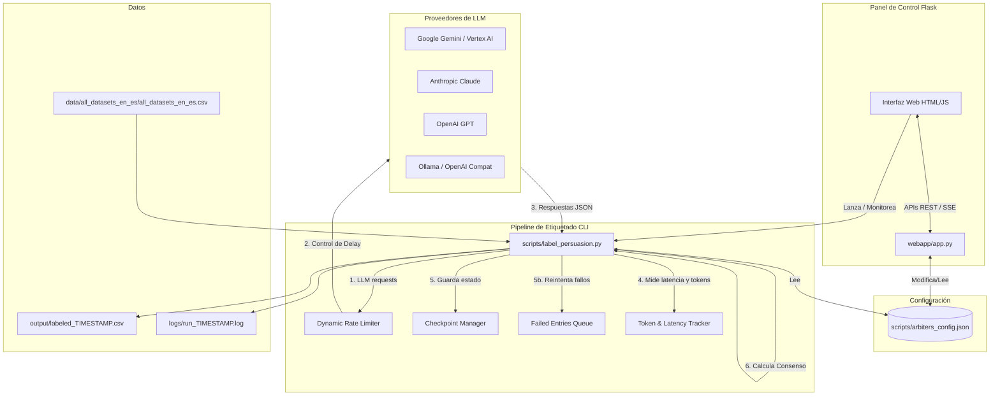

# LabelForge — Analizador de Principios de Persuasión

Este proyecto es una plataforma interactiva y un pipeline robusto diseñado para etiquetar de manera automática y masiva entradas textuales utilizando taxonomías configurables, incluida la taxonomía de **Principios de Persuasión de Ana Ferreira** (Ingeniería Social). El sistema emplea un enfoque multi-agente por consenso (árbitros con distintos perfiles profesionales/personas) con soporte para múltiples proveedores de Modelos de Lenguaje (LLM).

---

## 🏗️ Arquitectura General del Sistema

El proyecto consta de dos partes principales que interactúan entre sí a través del archivo de configuración central:

1. **Pipeline de Etiquetado (CLI)**: Ejecuta el procesamiento secuencial del dataset, realiza llamadas a las APIs de los LLMs, valida los formatos JSON devueltos, gestiona de forma dinámica los límites de peticiones (Rate Limits), almacena checkpoints para reanudar el proceso en caso de fallo, procesa la cola de entradas fallidas, calcula el consenso mayoritario y genera reportes detallados de **uso de tokens y latencia** por árbitro.
2. **Interfaz de Control (WebApp Flask)**: Proporciona un panel de control interactivo para administrar los árbitros, modificar los principios y las plantillas de prompts, ajustar parámetros de procesamiento en tiempo real, lanzar el etiquetado, visualizar los registros (logs) del sistema en tiempo real y consultar el **panel de métricas de tokens y latencia** del último run.



---

## 🎯 Principios de Persuasión (Taxonomía de Ana Ferreira)

El sistema analiza y evalúa la presencia (1) o ausencia (0) de cinco tácticas de influencia y persuasión psicológica en cada entrada textual:

*   **`AUTH` (Authority / Autoridad)**: Apela a figuras públicas, expertos, instituciones oficiales o credenciales para otorgar credibilidad o carácter coercitivo al mensaje.
*   **`SP` (Social Proof / Consenso Social)**: Implica que una creencia o comportamiento es compartido por una gran cantidad de personas, explotando la conformidad social y la conducta de rebaño.
*   **`LSD` (Liking, Similarity & Deception / Simpatía, Similitud y Engaño)**: Usa familiaridad, empatía simulada, halagos o encuadres engañosos para rebajar el juicio crítico del lector.
*   **`CRC` (Commitment, Reciprocation & Consistency / Compromiso, Reciprocidad y Coherencia)**: Apela a compromisos pasados, genera deudas morales/obligaciones o presiona al lector a actuar de manera coherente con sus creencias declaradas.
*   **`DIS` (Distraction / Distracción)**: Utiliza urgencia, escasez, miedo a la pérdida, sobrecarga emocional o sensacionalismo para desviar al lector de una evaluación racional y objetiva.

---

## 🌟 Características Clave

*   **Consenso por Mayoría**: Para cada entrada, múltiples árbitros independientes (por ejemplo, 3) evalúan de forma paralela. Se calcula la predicción de consenso mediante votación mayoritaria simple.
*   **Árbitros Expertos con Personas**: Cada árbitro se configura con un rol/persona particular (p. ej., Psicólogo Clínico, Especialista en Ciberseguridad, Investigador Forense) y una instrucción de sistema (`system_prompt`) adaptada para que evalúe el texto desde su perspectiva profesional particular.
*   **Dynamic Rate Limiter (Limitador Dinámico)**: Adapta el delay de peticiones automáticamente basándose en las respuestas del servidor. Si recibe un código `429` (Rate Limit) o un error `5xx`, aplica un multiplicador de *backoff* exponencial; si las llamadas tienen éxito de forma consecutiva, reduce el delay de manera progresiva hasta el límite inferior seguro.
*   **Resiliencia (Checkpoints y Cola de Reintentos)**:
    *   **Puntos de control**: Guarda el progreso cada $N$ entradas. Si la ejecución se detiene, se reanuda desde la última entrada procesada sin perder el trabajo completado.
    *   **Manejo de errores**: Si una entrada falla con un árbitro, se encola en `failed_queue.jsonl`. Al final de la corrida, el sistema reduce la velocidad del rate limiter e intenta procesar de nuevo únicamente las entradas fallidas antes de generar el reporte final.
*   **Métricas de Acuerdo Inter-Árbitros**: Al finalizar cada run, el módulo [`scripts/agreement_metrics.py`](scripts/agreement_metrics.py) calcula automáticamente estadísticas de fiabilidad entre evaluadores: acuerdo observado por pares, **Fleiss Kappa** (multi-árbitro), **Cohen's Kappa** (promedio por pares) y **Krippendorff's Alpha** nominal, tanto de forma global como desglosada por principio. Estas métricas son estándar para reportar en estudios con múltiples codificadores.
*   **Contabilidad Exhaustiva de Tokens**: Cada llamada al LLM registra los tokens de entrada (prompt), salida (completion) y total, tanto por llamada individual (en el CSV) como acumulados por árbitro y globalmente en el reporte final (log y webapp).
*   **Contabilidad Exhaustiva de Latencia**: El tiempo exacto de cada petición al LLM se mide con `time.perf_counter()` y se almacena en el CSV. El reporte final incluye latencia promedio, mínima, máxima y total acumulada por árbitro.
*   **Política de Seguridad (`free_only_mode`)**: Bloquea proveedores con riesgo de cargo (Vertex AI, Anthropic, OpenAI) cuando el modo seguro está activo, evitando consumo accidental de tokens de pago durante pruebas.
*   **Soporte Multimodelo y Multiproveedor**: Integra los SDKs oficiales de Google GenAI (`google-genai`), Vertex AI (`google-cloud-aiplatform`), Anthropic (`anthropic`) y OpenAI (`openai`), además de APIs locales u open-source compatibles con el protocolo de OpenAI (Ollama, LM Studio, vLLM).
*   **Logs Interactivos en la WebApp**: Utiliza Server-Sent Events (SSE) para transmitir la salida de consola de Python directamente a la pantalla de ejecución web en tiempo real (incluyendo el reporte de tokens y latencia al final).

---

## 📂 Estructura del Proyecto

*   **[`main_label.py`](file:///e:/Code/python/OpenCode/LabelForge/main_label.py)**: Punto de entrada principal para ejecutar el etiquetado a través de la terminal.
*   **[`main_webapp.py`](file:///e:/Code/python/OpenCode/LabelForge/main_webapp.py)**: Punto de entrada para inicializar la aplicación web Flask en modo local.
*   **`scripts/`**:
    *   **[`label_persuasion.py`](file:///e:/Code/python/OpenCode/LabelForge/scripts/label_persuasion.py)**: Contiene la lógica central del pipeline: controladores de API por proveedor, limitador dinámico de peticiones, procesamiento de checkpoints, consenso, **medición de tokens y latencia por llamada**, y generación del reporte final.
    *   **[`arbiters_config.json`](file:///e:/Code/python/OpenCode/LabelForge/scripts/arbiters_config.json)**: Archivo JSON central que almacena la configuración de los principios, los árbitros, los prompts del sistema y los parámetros del limitador de velocidad.
    *   **[`agreement_metrics.py`](file:///e:/Code/python/OpenCode/LabelForge/scripts/agreement_metrics.py)**: Módulo compartido de cálculo de métricas de acuerdo inter-árbitros (Fleiss Kappa, Cohen's Kappa, Krippendorff's Alpha).
    *   **[`utils.py`](file:///e:/Code/python/OpenCode/LabelForge/scripts/utils.py)**: Helper utilitario para parseo numérico y tipos de datos seguros.
*   **`webapp/`**:
    *   **[`app.py`](file:///e:/Code/python/OpenCode/LabelForge/webapp/app.py)**: Backend Flask de la aplicación web que gestiona los servicios API, el renderizado de plantillas, la ejecución del subproceso CLI de etiquetado y el **endpoint `/api/run/stats`** para métricas de tokens y latencia.
    *   **`templates/`**:
        *   [`base.html`](file:///e:/Code/python/OpenCode/LabelForge/webapp/templates/base.html): Estructura HTML común y hoja de estilos globales (diseño web oscuro y premium con Bootstrap).
        *   [`index.html`](file:///e:/Code/python/OpenCode/LabelForge/webapp/templates/index.html): Panel de control con estadísticas rápidas (árbitros, principios, salidas generadas, entradas en checkpoint).
        *   [`arbiters.html`](file:///e:/Code/python/OpenCode/LabelForge/webapp/templates/arbiters.html): Panel de gestión de árbitros (CRUD completo, asignación de modelos, tokens y claves API).
        *   [`principles.html`](file:///e:/Code/python/OpenCode/LabelForge/webapp/templates/principles.html): Visualización y edición de los principios de persuasión y la plantilla del prompt del usuario.
        *   [`processing.html`](file:///e:/Code/python/OpenCode/LabelForge/webapp/templates/processing.html): Panel de configuración de parámetros de red, checkpoints y cálculos de tiempos/delays recomendados.
        *   [`run.html`](file:///e:/Code/python/OpenCode/LabelForge/webapp/templates/run.html): Interfaz interactiva de lanzamiento y monitorización del proceso de etiquetado con streaming de logs por SSE y **panel de métricas de tokens y latencia** post-run.
*   **`data/`**: Directorio para los archivos de datos de entrada. El dataset principal (`data/all_datasets_en_es/all_datasets_en_es.csv`) es **privado** (investigación en curso) y está excluido del repositorio mediante `.gitignore`. Se publicará al concluir el estudio.
*   **`output/`**: Carpeta de destino para los datasets etiquetados resultantes (`labeled_YYYYMMDD_HHMMSS.csv`).
*   **`checkpoints/`**: Almacena el estado intermedio de ejecuciones: `checkpoint.json`, `failed_queue.jsonl`, `run_state.json`, `claim_results.jsonl` y `arbiter_results.jsonl`. **Excluido del repositorio** (datos de estado local privados).
*   **`logs/`**: Almacena los registros detallados de cada ejecución del pipeline (`run_YYYYMMDD_HHMMSS.log`), incluyendo el reporte completo de tokens y latencia al final.
*   **`tests/`**: Contiene la suite de pruebas unitarias automáticas ([`test_pipeline.py`](file:///e:/Code/python/OpenCode/LabelForge/tests/test_pipeline.py)) para auditar el correcto funcionamiento de utilidades, métricas y seguridad.

---

## 🛠️ Requisitos e Instalación

### 1. Requisitos de Software
*   Python 3.10 o superior (Recomendado 3.11)
*   Conda / Miniconda (opcional, recomendado para entornos aislados)

### 2. Configuración del Entorno de Conda
Puedes recrear el entorno de desarrollo usando el archivo [`environment.yml`](file:///e:/Code/python/OpenCode/LabelForge/environment.yml):

```bash
conda env create -f environment.yml
conda activate LabelForge
```

Alternativamente, si utilizas un entorno de Python estándar (`venv`), instala las dependencias fijadas en [`requirements.txt`](file:///e:/Code/python/OpenCode/LabelForge/requirements.txt):

```bash
pip install -r requirements.txt
```

### 3. Configuración de Variables de Entorno (`secrets.env`)
Crea el archivo [`secrets.env`](file:///e:/Code/python/OpenCode/LabelForge/secrets.env) en la raíz del proyecto copiando la plantilla [`secrets.env.example`](file:///e:/Code/python/OpenCode/LabelForge/secrets.env.example) y edítalo para incluir tus credenciales y claves API de los diferentes proveedores que desees utilizar:

```env
# Google Gemini (API Key estándar)
GEMINI_API_KEY=tu_clave_de_gemini_aqui

# Anthropic Claude
ANTHROPIC_API_KEY=tu_clave_de_anthropic_aqui

# OpenAI ChatGPT
OPENAI_API_KEY=tu_clave_de_openai_aqui

# Google Cloud / Vertex AI
GOOGLE_CLOUD_PROJECT=id_del_proyecto_gcp
VERTEX_LOCATION=us-central1

# Servidor web (opcionales — descomenta para cambiar los valores por defecto)
# LABELFORGE_HOST=127.0.0.1   # 0.0.0.0 para acceso desde la red local
# LABELFORGE_PORT=7860         # Puerto libre en macOS, Windows y Linux
```

> **Nota sobre macOS**: el puerto `5000` está ocupado por el servicio AirPlay
> Receiver desde macOS 12 Monterey. LabelForge usa `7860` por defecto para
> evitar ese conflicto. Si necesitas otro puerto, define `LABELFORGE_PORT` en
> `secrets.env` o usa el argumento `--port` en la línea de comandos.

### 4. Autenticación para Vertex AI (Google Cloud)

Si usas `vertex_gemini` como proveedor, debes autenticarte con Application Default Credentials (ADC). Ejecuta **una sola vez** en la máquina donde corre el pipeline:

```bash
gcloud auth application-default login
gcloud auth application-default set-quota-project TU_PROJECT_ID
```

Esto guarda las credenciales localmente para que el SDK de Vertex AI las use de forma automática sin necesidad de una API Key en `secrets.env`.

### 5. Ejecución de Pruebas Unitarias

El proyecto cuenta con pruebas automáticas para garantizar la estabilidad y consistencia de las métricas matemáticas y helpers de conversión. Ejecútalas usando:

```bash
python -m unittest tests/test_pipeline.py
```

---

## 🚀 Instrucciones de Uso

El proyecto se puede controlar completamente tanto de forma visual (WebApp) como directa (CLI).

### Opción A: Interfaz Web (Recomendado)

Inicia el servidor Flask ejecutando:

```bash
python main_webapp.py
```

Por defecto, la webapp arrancará en `http://127.0.0.1:7860`.
Puedes especificar argumentos adicionales en consola:
*   `--port`: Cambiar el puerto del servidor (ej. `--port 8080`).
*   `--host`: Configurar el host (ej. `--host 0.0.0.0` para acceso en red local).
*   `--debug`: Ejecutar en modo desarrollo con recarga automática (*hot reloader*).


#### Flujo de trabajo en la Webapp:
1.  **Panel de Inicio**: Observa el estado actual del dataset, los árbitros activos y el último checkpoint.
2.  **Gestionar Árbitros**: Ve a la pestaña **Arbitros** para agregar nuevos perfiles o modificar los modelos de lenguaje utilizados por cada uno (p. ej., cambiar de `gemini-2.5-pro` a `gemini-2.5-flash`).
3.  **Configurar Parámetros**: En **Procesamiento**, selecciona tu nivel de facturación (Free o Paid) para recibir recomendaciones automáticas de delay seguro. Ajusta los límites según el rendimiento observado.
4.  **Ejecutar**: En la pestaña **Ejecutar**, define una cantidad límite de entradas para probar (ej. `10` o `50`) y presiona **Iniciar Etiquetado**. Verás el progreso detallado y los reportes directamente en el visor de logs.
5.  **Panel de Métricas**: Al finalizar el run, el panel **"Tokens y Latencia del último run"** se actualiza automáticamente mostrando las estadísticas completas de consumo (ver sección siguiente).

---

### Opción B: Ejecución por Terminal (CLI)

Para ejecutar el pipeline directamente desde consola sin usar el servidor web, utiliza el script [`main_label.py`](file:///e:/Code/python/OpenCode/LabelForge/main_label.py):

```bash
# Procesar únicamente las primeras 10 entradas para prueba
python main_label.py --limit 10

# Procesar todo el dataset completo
python main_label.py

# Utilizar un archivo de configuración JSON personalizado y procesar 50 entradas
python main_label.py --config scripts/mi_configuracion.json --limit 50

# Especificar un dataset de entrada diferente
python main_label.py --input data/otro_dataset.csv
```

#### Argumentos soportados en CLI:
*   `--config`: Ruta absoluta o relativa al JSON de configuración (default: `scripts/arbiters_config.json`).
*   `--input`: Ruta al archivo CSV con las entradas a etiquetar (default: `data/all_datasets_en_es/all_datasets_en_es.csv`). Por compatibilidad con datasets previos, el CSV de entrada debe contener una columna llamada `claim`; en la UI y documentación nueva esa columna se interpreta como el texto de la entrada.
*   `--limit`: Limita la cantidad de filas a procesar (entero). Si se omite, se procesará todo el archivo.

---

## 📊 Contabilidad de Tokens y Latencia

El sistema registra de forma exhaustiva el consumo de tokens y el tiempo de respuesta de cada llamada a los LLMs. Esta información se almacena en **tres lugares simultáneamente**:

### 1. En el CSV de salida (por entrada y por árbitro)

Cada fila del CSV etiquetado incluye las siguientes columnas adicionales para cada árbitro (`[arb_id]` es el identificador del árbitro, p. ej. `arb1`, `arb2`, `arb3`):

| Columna | Descripción |
|---|---|
| `prompt_tokens_[arb_id]` | Tokens de entrada enviados en el prompt a ese árbitro |
| `completion_tokens_[arb_id]` | Tokens generados en la respuesta de ese árbitro |
| `total_tokens_[arb_id]` | Suma de prompt + completion tokens para ese árbitro |
| `latency_s_[arb_id]` | Tiempo de respuesta de la llamada al LLM en segundos |

> Los campos se marcan con `-1` si la entrada falló definitivamente en ese árbitro.

### 2. En el archivo de log (reporte final al terminar el run)

Al finalizar cada ejecución, el reporte aparece en consola **y** se guarda automáticamente en `logs/run_YYYYMMDD_HHMMSS.log`:

```
=== REPORTE DE CONSUMO DE TOKENS Y LATENCIA ===
  Arbitro arb1 (Psicologo Clinico):
    Tokens Entrada (Prompt)     : 2859
    Tokens Salida (Completion)  : 1977
    Tokens Totales              : 4836
    Latencia Promedio           : 47.823s
    Latencia Min / Max          : 38.102s / 61.445s
    Latencia Total Acumulada    : 478.230s (10 llamadas)
  Arbitro arb2 (Especialista Ciberseguridad):
    ...
  CONSUMO GLOBAL TOTAL DEL RUN  : 14685 tokens
```

### 3. En la WebApp (panel visual post-run)

La pestaña **Ejecutar** incluye el panel **"Tokens y Latencia del último run"** que se actualiza automáticamente al terminar cada ejecución. El panel muestra:

*   **KPIs globales**: Tokens totales del run, número de entradas etiquetadas y promedio de tokens por entrada.
*   **Tabla por árbitro**: Tokens de entrada, salida y total; número de llamadas; latencia promedio, mínima/máxima y latencia total acumulada.

El panel también se carga al abrir la página si ya existe un CSV previo, gracias al endpoint `GET /api/run/stats`.

---

## 📈 Resultados y Reportes

Cuando el proceso finaliza de forma exitosa (o es detenido y concluido), los resultados se guardan en la carpeta `output/` con el nombre `labeled_YYYYMMDD_HHMMSS.csv`.

El CSV resultante conservará todas las columnas originales del dataset e incorporará las siguientes columnas adicionales para cada principio de persuasión (`P = AUTH, SP, LSD, CRC, DIS`) y cada árbitro:

| Columna | Descripción |
|---|---|
| `[P]_[arbiter_id]` | Evaluación individual de ese árbitro (1 = presente, 0 = ausente) |
| `[P]_[arbiter_id]_why` | Justificación breve en lenguaje natural aportada por el árbitro |
| `[P]_consensus` | Evaluación por mayoría consensuada de todos los árbitros (1 ó 0) |
| `prompt_tokens_[arbiter_id]` | Tokens de entrada consumidos por ese árbitro en esta entrada |
| `completion_tokens_[arbiter_id]` | Tokens de salida generados por ese árbitro en esta entrada |
| `total_tokens_[arbiter_id]` | Total de tokens consumidos por ese árbitro en esta entrada |
| `latency_s_[arbiter_id]` | Latencia de la llamada al LLM de ese árbitro en segundos |

Si una entrada falla permanentemente después de la cola de reintentos, el consenso se marcará con `-1` y la justificación se registrará como `FAILED`.

---

## 🔌 API Endpoints de la WebApp

### Páginas

| Método | Endpoint | Descripción |
|---|---|---|
| `GET` | `/` | Panel de inicio (dashboard) |
| `GET` | `/arbiters` | Gestión de árbitros |
| `GET` | `/principles` | Principios y plantilla del prompt |
| `GET` | `/processing` | Parámetros de procesamiento |
| `GET` | `/run` | Interfaz de ejecución y monitoreo |

### Ejecución y monitoreo

| Método | Endpoint | Descripción |
|---|---|---|
| `POST` | `/api/run/start` | Inicia el pipeline de etiquetado |
| `POST` | `/api/run/stop` | Detiene el proceso en curso |
| `GET` | `/api/run/status` | Estado actual del proceso (running / idle) |
| `GET` | `/api/run/current-stats` | Métricas en vivo del run activo (tokens, latencia, progreso) |
| `GET` | `/api/run/logs` | Stream SSE de logs en tiempo real |
| `GET` | `/api/run/stats` | Estadísticas de tokens, latencia y métricas de acuerdo del último CSV |

### Árbitros

| Método | Endpoint | Descripción |
|---|---|---|
| `GET` | `/api/arbiters` | Lista todos los árbitros configurados |
| `POST` | `/api/arbiters` | Crea un nuevo árbitro |
| `GET` | `/api/arbiters/<arb_id>` | Obtiene un árbitro por ID |
| `PUT` | `/api/arbiters/<arb_id>` | Actualiza un árbitro existente |
| `DELETE` | `/api/arbiters/<arb_id>` | Elimina un árbitro |

### Principios y configuración

| Método | Endpoint | Descripción |
|---|---|---|
| `GET` | `/api/principles` | Lista los principios configurados |
| `PUT` | `/api/principles` | Actualiza la lista de principios |
| `GET` | `/api/prompt-template` | Obtiene la plantilla de prompt y configuración de justificaciones |
| `PUT` | `/api/prompt-template` | Actualiza la plantilla de prompt |
| `GET` | `/api/processing` | Obtiene los parámetros de procesamiento |
| `PUT` | `/api/processing` | Actualiza los parámetros de procesamiento |
| `GET` | `/api/config` | Configuración completa (árbitros + principios + parámetros) |

### Modelos y rate limits

| Método | Endpoint | Descripción |
|---|---|---|
| `GET` | `/api/models` | Lista modelos disponibles para un proveedor (`?provider=gemini\|anthropic\|openai\|ollama`) |
| `GET` | `/api/rate-limits` | Límites de velocidad y delay mínimo recomendado para un modelo |
| `GET` | `/api/rate-limits/summary` | Resumen de rate limits y delay global para todos los árbitros configurados |

### Outputs y checkpoint

| Método | Endpoint | Descripción |
|---|---|---|
| `GET` | `/api/outputs` | Lista los CSVs generados en `output/` con metadata |
| `GET` | `/outputs/<name>` | Descarga un CSV de salida por nombre |
| `DELETE` | `/api/outputs/<name>` | Elimina un CSV de salida |
| `GET` | `/api/checkpoint/status` | Estado del checkpoint actual y del run pausado |
| `POST` | `/api/checkpoint/clear` | Limpia el checkpoint y todos los archivos de estado |
| `GET` | `/api/failed-queue` | Cola de entradas fallidas pendientes de reintento |

---

## ⚙️ Detalles Técnicos Relevantes

### Vertex AI — Configuración de `max_output_tokens`

Los modelos de razonamiento como `gemini-2.5-pro` generan tokens de "pensamiento" (thinking tokens) que **se descuentan del límite de `max_output_tokens`**. Por esta razón, la configuración usa un valor de `8192` tokens en lugar del valor por defecto de `600`. Si se reduce este valor en modelos de razonamiento, las respuestas JSON se truncan parcialmente, causando errores de parseo.

La configuración de generación se pasa como **diccionario plano** (no como objeto `GenerationConfig`) para evitar un bug del SDK de Vertex AI con versiones recientes de Gemini que causaba truncamiento silencioso de respuestas.

### Política de Seguridad (`free_only_mode`)

Cuando `safety.free_only_mode = true` en `scripts/arbiters_config.json`, el pipeline bloquea en el arranque cualquier árbitro que use un proveedor con riesgo de costo:

| Permitidos por defecto | Bloqueados por defecto |
|---|---|
| `gemini` (AI Studio) | `vertex_gemini` |
| `ollama` | `anthropic` |
| `openai_compat` local (`127.0.0.1`, `localhost`) | `openai` |
| | `openai_compat` remoto |

Para desactivarlo, cambia `free_only_mode` a `false` o añade el proveedor a `allowed_provider_types` en la configuración.

### Módulo de Utilidades Compartidas (`scripts/utils.py`)

Contiene las funciones de conversión numérica segura usadas por todos los módulos del proyecto:
- `safe_int(v)`: convierte a entero, devuelve `0` si no es posible.
- `safe_float(v)`: convierte a float, devuelve `0.0` si no es posible.
- `safe_binary_int(v)`: convierte a `0` o `1` (útil para etiquetas binarias leídas de CSV como strings).
- `number(v, default)`: conversión numérica genérica con fallback configurable.

### Módulo de Acuerdo Inter-Árbitros (`scripts/agreement_metrics.py`)

Módulo compartido entre el pipeline CLI y la WebApp que centraliza el cálculo de métricas de fiabilidad:
- **Fleiss Kappa**: acuerdo multi-árbitro con múltiples categorías.
- **Cohen's Kappa (promedio por pares)**: comparación entre cada par de árbitros.
- **Krippendorff's Alpha nominal**: tolera datos faltantes.
- **Acuerdo observado promedio** y **tasa positiva** por principio.

Las métricas se calculan tanto de forma global como desglosadas por principio y se exponen en `/api/run/stats`.

### Configuración del Servidor Web

Jerarquía de precedencia para host y puerto del servidor Flask:

```
--host / --port (CLI)  >  LABELFORGE_HOST / LABELFORGE_PORT (env)  >  127.0.0.1:7860 (default)
```

- **Puerto por defecto `7860`**: libre en macOS (donde el `5000` está ocupado por AirPlay Receiver desde Monterey), Windows y Linux.
- **Las variables de entorno** pueden definirse en `secrets.env` sin necesidad de tocar el código fuente.

### Logging Dual (Consola + Fichero)

El logger de Python usa `logging.basicConfig` con dos handlers simultáneos:
- `FileHandler` → `logs/run_YYYYMMDD_HHMMSS.log`
- `StreamHandler` → stdout (capturado por el SSE de la webapp)

Esto garantiza que **toda la salida visible en consola**, incluyendo el reporte final de tokens y latencia, quede también persistida en el archivo de log.
